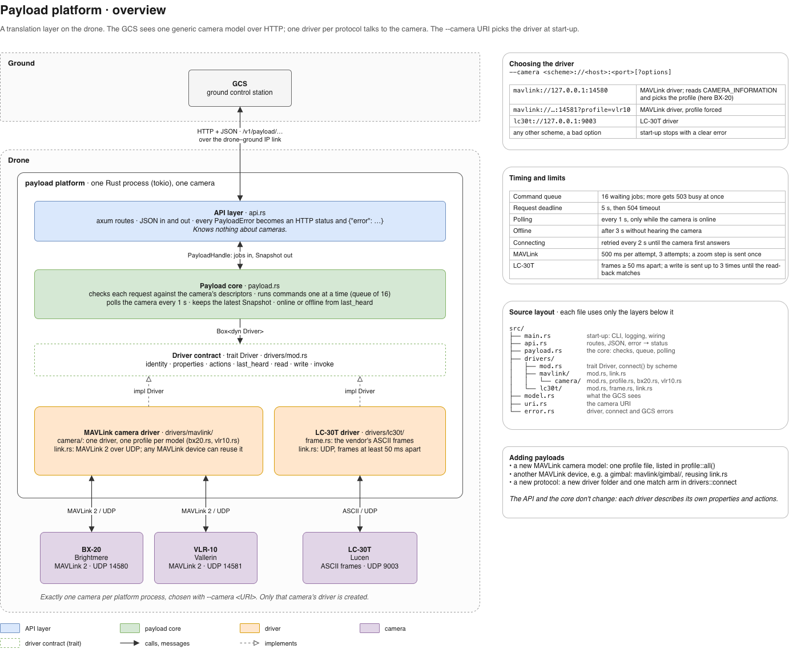

# Payload Platform

A translation layer that runs on the drone, between one camera payload and the ground control station (GCS). The GCS controls every supported camera through the same API, and the platform translates each request into the attached camera's own protocol.

Supported cameras, simulated in [`camera-simulations/`](camera-simulations/README.md), with vendor documents in [`specs/`](specs/):

| Camera | Protocol | Simulator port |
| --- | --- | --- |
| Brightmere BX-20 | MAVLink 2 camera protocol | 14580 |
| Optronique Vallerin VLR-10 | MAVLink 2 camera protocol | 14581 |
| Lucen LC-30T | Vendor ASCII protocol over UDP | 9003 |

> **Status:** working with all three cameras. The code is in [`platform/`](platform/). [Running it](#running-it) and [Tests](#tests) show how to try it, and [Design](#design) explains it.

## Contents

* [Running it](#running-it)
* [Metrics and Grafana](#metrics-and-grafana)
* [Trying the API](#trying-the-api)
* [Tests](#tests)
* [Design](#design)
  * [Scope](#scope)
  * [Approach](#approach)
  * [Architecture](#architecture)
  * [Payload model](#payload-model)
  * [GCS API](#gcs-api)
  * [Errors](#errors)
  * [Camera URI](#camera-uri)
  * [Translation per camera](#translation-per-camera)
  * [Timing and liveness](#timing-and-liveness)
  * [Driver contract](#driver-contract)
  * [Adding new payload types](#adding-new-payload-types)
  * [Decisions and trade-offs](#decisions-and-trade-offs)
  * [Limitations and next steps](#limitations-and-next-steps)

## Running it

You need Rust 1.88 or later, plus `curl` (7.82 or later, for `--json`) and `jq` for the demo.

Run one simulator, then the platform with that camera's URI, each in its own terminal:

```sh
cd camera-simulations && cargo run --release -- bx20    # or vlr10, or lc30t
cd platform && cargo run -- --camera mavlink://127.0.0.1:14580
```

| Camera | URI |
| --- | --- |
| BX-20 | `mavlink://127.0.0.1:14580` |
| VLR-10 | `mavlink://127.0.0.1:14581` |
| LC-30T | `lc30t://127.0.0.1:9003` |

Then use the API as a GCS would:

```sh
curl -s localhost:8080/v1/payload | jq
curl -s -X PUT localhost:8080/v1/payload/properties/zoom --json '{"value": 7}'
```

[Trying the API](#trying-the-api) has more requests, including one for each error.

In zsh, put a URI that contains `?` in quotes, such as `"mavlink://127.0.0.1:14581?profile=vlr10"`: zsh treats `?` as a wildcard.

**Demo.** `platform/demo.sh` starts the three simulators and a platform for each camera, with the APIs on ports 8080, 8081 and 8082. It runs the same scenario on every camera through the API, prints each request with its answer and how long it took, then stops everything. `platform/demo.sh http://127.0.0.1:8080` runs the scenario on a platform that's already running.

**Log files.** The logs always go to the terminal. With `--log-dir`, they also go to one file per day in that folder, and only the last 7 days are kept, so they can't fill the drone's storage:

```sh
cd platform && cargo run -- --camera mavlink://127.0.0.1:14580 --log-dir logs    # logs/platform.<date>.log
```

On a real drone the platform would run as a service, whose journal (systemd's journald) could keep the terminal output instead. `--log-dir` is for when there's no journal, or a copy should go somewhere else.

What gets logged: start-up, the camera connecting and going online or offline, and one line for every write or action, with what was asked and how it ended:

```
INFO platform::payload: write zoom = 4.0: ok, now 4.0
WARN platform::payload: write zoom = 6.0: failed, timeout: the camera didn't confirm in time; read the value before retrying
```

Reads (GETs) and the once-a-second polls aren't logged, so a quiet platform writes almost nothing to the drone's storage.

Everything above is the normal build, without metrics. That's the build for the drone.

## Metrics and Grafana

Metrics are for development and bench tests, so they're a Cargo feature, `prometheus`, which is off by default:

| | Build | Run |
| --- | --- | --- |
| Without metrics: the drone | `cargo build --release` | `cargo run -- --camera …` |
| With metrics: development | `cargo build --features prometheus` | `cargo run --features prometheus -- --camera … --metrics-listen 0.0.0.0:9000` |

- `--features prometheus` is a cargo option, so it goes before the `--`. It decides **at compile time** whether metrics exist. Without it, the metrics crates aren't compiled in, and the platform has no `--metrics-listen` option.
- `--metrics-listen` is a platform option, so it goes after the `--`. It decides **at run time** whether metrics are served, and where: `http://<address>/metrics`. Without it, even the metrics build serves nothing.
- The metrics get a port of their own, separate from the GCS API, so they never travel over the drone–ground link.

**With Grafana.** Only Prometheus and Grafana run in Docker; the simulators and the platforms run as usual. The data source and the dashboard are loaded from [`monitoring/`](monitoring/) every time Grafana starts, so nobody has to create them:

```sh
docker compose -f monitoring/docker-compose.yml up -d    # from the repository root: Prometheus :9090, Grafana :3000
platform/demo.sh --metrics                               # 3 simulators + 3 platforms with metrics, then traffic until Ctrl-C
open http://localhost:3000                               # the dashboard opens as the home page
docker compose -f monitoring/docker-compose.yml down     # when you're done
```

- **Prometheus collects from ports 9000, 9001 and 9002,** the ports `demo.sh --metrics` uses. A single platform started with `--metrics-listen 0.0.0.0:9000` shows up as well.
- **Grafana opens without a login, as a viewer.** To change the dashboard, sign in as `admin` / `admin`, edit it, export it (Share → Export → Save to file), and replace `monitoring/grafana/dashboards/payload-platform.json`.
- **To see a camera go offline** while the demo runs: `pkill -f "camera-sim lc30t"`.

The dashboard has a camera menu and three rows:
- **Cameras:** identity, online or offline, time since last heard, the queue, and an online timeline.
- **Requests from the GCS:** requests by status, errors by code, and the 95th-percentile duration of requests and of the camera work behind them.
- **Inside the platform:** queue depth, resends and unanswered requests, and polls.

| Metric | Type | What it counts |
| --- | --- | --- |
| `payload_http_requests_total`, `payload_http_request_duration_seconds` | counter, histogram | every request from the GCS, by method, route and status |
| `payload_errors_total` | counter | errors sent to the GCS, by code |
| `payload_job_duration_seconds` | histogram | the camera work of each write or action, without the queue |
| `payload_queue_depth` | gauge | jobs waiting for the core, out of 16 |
| `payload_camera_online`, `payload_camera_last_heard_seconds` | gauges | liveness, updated every second |
| `payload_camera_info` | gauge, always 1 | the camera's identity, in its labels; the dashboard uses it to show camera names |
| `payload_polls_total` | counter | polls of the camera, by outcome |
| `payload_camera_resends_total`, `payload_camera_unanswered_total` | counters | requests sent to the camera again, and requests it never answered |

In the code, every `#[cfg(feature = "prometheus")]` is in `platform/src/telemetry.rs`. The rest of the code calls its functions the same way in both builds; in the build without metrics they're empty, and the compiler removes them. Because the compiler only checks the build it's asked for, check both:

```sh
cargo clippy --all-targets && cargo clippy --all-targets --features prometheus
cargo test && cargo test --features prometheus    # the second also runs the metrics test
```

## Trying the API

### Starting the platform

From `platform/`, with the BX-20 simulator running (`cd camera-simulations && cargo run --release -- bx20`):

```sh
cargo run -- --camera mavlink://127.0.0.1:14580                          # BX-20, profile detected
cargo run -- --camera "mavlink://127.0.0.1:14580?profile=bx20"           # profile forced (quotes for zsh)
cargo run -- --camera mavlink://127.0.0.1:14580 --listen 127.0.0.1:9090  # the API on another port
cargo run -- -c mavlink://127.0.0.1:14580 -l 127.0.0.1:9090              # the same, with the short flags
cargo run -- --camera mavlink://127.0.0.1:14580 --log-dir logs           # logs also to logs/platform.<date>.log
RUST_LOG=debug cargo run -- --camera mavlink://127.0.0.1:14580           # more detailed logs
cargo run --release -- --camera mavlink://127.0.0.1:14580                # optimised build, as on the drone
cargo run -- --help                                                      # every option

# The other cameras, each with its own simulator running
cargo run -- --camera mavlink://127.0.0.1:14581                          # VLR-10, profile detected
cargo run -- --camera "mavlink://127.0.0.1:14581?profile=vlr10"          # VLR-10, profile forced
cargo run -- --camera lc30t://127.0.0.1:9003                             # LC-30T
cargo run -- --camera "lc30t://127.0.0.1:9003?interval_ms=100"           # LC-30T, 100 ms between frames

# With metrics (see "Metrics and Grafana")
cargo run --features prometheus -- --camera mavlink://127.0.0.1:14580 --metrics-listen 0.0.0.0:9000
curl -s localhost:9000/metrics | grep ^payload                            # what Prometheus collects
```

Start-up errors worth trying. Each one stops the platform at once, with a clear message:

```sh
cargo run -- --camera "mavlink://127.0.0.1:14580?profil=bx20"      # unknown option `profil`; this driver accepts: profile, system_id, component_id
cargo run -- --camera "mavlink://127.0.0.1:14580?profile=xyz"      # unknown profile `xyz`; known profiles: bx20, vlr10
cargo run -- --camera "mavlink://127.0.0.1:14580?system_id=abc"    # option `system_id` has an invalid value `abc`
cargo run -- --camera "lc30t://127.0.0.1:9003?interval=100"        # unknown option `interval`; this driver accepts: interval_ms
cargo run -- --camera mavlink://127.0.0.1                          # the camera URI needs a host and a port
cargo run -- --camera http://127.0.0.1:14580                       # unknown camera URI scheme `http`; known schemes: mavlink, lc30t
cargo run -- --camera "not a uri"                                  # `not a uri` is not valid URI
cargo run -- --camera mavlink://127.0.0.1:14580 --log-dir /dev/null/x   # can't write logs to /dev/null/x
cargo run -- --camera mavlink://127.0.0.1:14580 --metrics-listen 0.0.0.0:9000   # error: unexpected argument: no metrics in this build
```

A camera that isn't running yet is not an error. With no simulator, `cargo run -- --camera mavlink://127.0.0.1:14580` logs `no heartbeat from 127.0.0.1:14580; retrying in 2s` and connects as soon as the camera answers. Meanwhile `GET /v1/payload` reports `"status": "connecting"`.

### Requests

These requests assume the BX-20 is attached (`mavlink://127.0.0.1:14580`). Ranges and options come from the attached camera: `{"value": 25}` is out of range on the BX-20 but a valid zoom on the LC-30T (1–30×), and `lava` is one of the LC-30T's palettes. `-i` adds the status line to the output, and `| jq` makes the JSON easier to read.

Normal use:

```sh
# Reading: answered at once from the platform's cache, without asking the camera
curl -s localhost:8080/v1/payload                                   # everything
curl -s localhost:8080/v1/payload/properties/zoom
curl -s localhost:8080/v1/payload/properties/sensor
curl -s localhost:8080/v1/payload/properties/thermal_palette

# Writing: queued as a Job::Write; returns the property as the camera reports it afterwards
curl -s -X PUT localhost:8080/v1/payload/properties/zoom            --json '{"value": 1}'
curl -s -X PUT localhost:8080/v1/payload/properties/zoom            --json '{"value": 20}'
curl -s -X PUT localhost:8080/v1/payload/properties/zoom            --json '{"value": 10.5}'
curl -s -X PUT localhost:8080/v1/payload/properties/sensor          --json '{"value": "thermal"}'
curl -s -X PUT localhost:8080/v1/payload/properties/sensor          --json '{"value": "visible"}'
curl -s -X PUT localhost:8080/v1/payload/properties/thermal_palette --json '{"value": "ironbow"}'
curl -s -X PUT localhost:8080/v1/payload/properties/thermal_palette --json '{"value": "rainbow"}'

# Actions: queued as a Job::Invoke; return the properties they changed
curl -s -X POST localhost:8080/v1/payload/actions/zoom_step --json '{"direction": "in"}'    # zoom 11.5
curl -s -X POST localhost:8080/v1/payload/actions/zoom_step --json '{"direction": "out"}'   # zoom 10.5
```

Expected errors, grouped by the answer (see [Errors](#errors) for the body):

```sh
# 200, but rounded to the resolution: the answer shows "value": 4.0
curl -s -X PUT localhost:8080/v1/payload/properties/zoom --json '{"value": 4.04}'

# 422 out_of_range, with minimum and maximum in details
curl -s -i -X PUT localhost:8080/v1/payload/properties/zoom --json '{"value": 25}'
curl -s -i -X PUT localhost:8080/v1/payload/properties/zoom --json '{"value": 0.5}'

# 422 unsupported_value, with the options in details
curl -s -i -X PUT localhost:8080/v1/payload/properties/thermal_palette --json '{"value": "lava"}'
curl -s -i -X PUT localhost:8080/v1/payload/properties/sensor          --json '{"value": "night"}'
curl -s -i -X POST localhost:8080/v1/payload/actions/zoom_step         --json '{"direction": "up"}'

# 400 invalid_request: the wrong type
curl -s -i -X PUT localhost:8080/v1/payload/properties/zoom            --json '{"value": "max"}'
curl -s -i -X PUT localhost:8080/v1/payload/properties/thermal_palette --json '{"value": 2}'

# 400 invalid_request: a body the platform can't read
curl -s -i -X PUT localhost:8080/v1/payload/properties/zoom --json '{"valeu": 4}'     # typo: unknown field
curl -s -i -X PUT localhost:8080/v1/payload/properties/zoom --json '{"value": true}'  # neither a number nor text
curl -s -i -X PUT localhost:8080/v1/payload/properties/zoom --json 'not json'
curl -s -i -X PUT localhost:8080/v1/payload/properties/zoom                           # no body

# 400 invalid_request: bad action arguments
curl -s -i -X POST localhost:8080/v1/payload/actions/zoom_step --json '{}'                               # missing direction
curl -s -i -X POST localhost:8080/v1/payload/actions/zoom_step --json '{"direction": "in", "speed": 2}'  # unknown argument

# 404 not_found
curl -s -i localhost:8080/v1/payload/properties/focus
curl -s -i -X PUT  localhost:8080/v1/payload/properties/focus --json '{"value": 1}'
curl -s -i -X POST localhost:8080/v1/payload/actions/record   --json '{}'
curl -s -i localhost:8080/v1/nothing

# 405: the wrong method on a known path
curl -s -i -X DELETE localhost:8080/v1/payload/properties/zoom
```

- Every error comes with the `{"error": …}` body except the 405. axum sends that one before the platform's code runs, with an empty body and an `allow: GET,HEAD,PUT` header.
- axum would answer a request with no body with 415. The platform answers 400 `invalid_request` for every body it can't read, so a GCS has one code to handle.
- While the camera is offline, `PUT` and `POST` answer 503 `payload_offline` before they look the id up, so `PUT focus` gets 503 instead of 404. A `GET` still answers from the cache.

## Tests

```sh
cd platform
cargo test        # unit, end-to-end and fault tests: about 15 s
cargo test --release --test bench -- --ignored --nocapture --test-threads 1    # benchmarks
```

The end-to-end, fault and benchmark tests run the real simulators and the real platform as separate processes, and call the API like a GCS. Each simulator has a fixed port, so stop any simulator you're running first. The tests build the simulators if that hasn't been done yet.

- **Unit tests**, next to the code in `src/`: each translation on its own, such as zoom percentages and steps, firmware numbers, LC-30T frames and checksums (checked against the examples in the vendor documents), URI parsing, and the checks every request goes through.
- **`tests/e2e.rs`**: one scenario, written only against the API, passes unchanged on all three cameras. Each camera describes itself correctly and rounds zoom requests to its own resolution. A camera that stops is shown `offline` within a few seconds, and the platform comes back online on its own when the camera restarts. A camera that starts after the platform is waited for, and a wrong URI stops the platform at once.
- **`tests/faults.rs`**: a proxy between the platform and the camera loses chosen datagrams. A lost LC-30T write is resent and still succeeds, and one that never arrives ends in `rejected`. A lost BX-20 answer leads to a resend, and three lost answers end in `timeout`. A VLR-10 step is never resent, so a lost answer ends in `timeout`, with the zoom part of the way.
- **`tests/bench.rs`**: how long each operation takes on each camera, as the GCS sees it, and what a burst of 30 simultaneous writes does.

Benchmark results, with the simulators on the same computer (release build, median in milliseconds):

| Operation | BX-20 | VLR-10 | LC-30T |
| --- | --- | --- | --- |
| read a property (from the cache) | 0.1 | 0.2 | 0.3 |
| set `zoom` | 0.4 | 0.7 | 104 |
| `zoom_step` | 0.3 | 0.4 | 157 |
| set `sensor` | 0.3 | 0.2 | 104 |
| set `thermal_palette` | 0.1 | 0.1 | 104 |
| burst of 30 writes at once | 18 done, 12 `busy` | 18 done, 12 `busy` | 17 done, 13 `busy` |

- Nearly all the time is spent waiting for the camera. The simulators answer at once, so real cameras will be slower, the MAVLink ones included.
- An LC-30T write takes about 100 ms because the vendor asks for at least 50 ms between frames: the write, then 50 ms later the read-back that confirms it. `zoom_step` reads first, so it takes three frames. A write that lands just behind the once-a-second poll also waits for the poll's three reads, which is why a few writes take up to about 300 ms.
- In the burst, the core runs one write and queues 16 more. The rest are answered `busy` at once instead of piling up (see "Timing and liveness").

## Design

### Scope

In scope:

- One camera per platform instance, chosen at start-up with a URI.
- Camera identity, connection status, zoom, active sensor (visible or thermal) and thermal palette.
- One API for the GCS that behaves the same for every camera and works over an IP link between drone and ground.

Out of scope: video streaming, gimbal control, photo and video capture, focus, several cameras at once, and authentication or encryption of the GCS link.

### Approach

The design starts from a per-camera inventory of the three vendor documents and simulators: how each camera is identified, how it zooms, switches sensor and changes palette, how it confirms a change, and how to tell that it is alive. The API offers the common set of those operations in camera-independent units, plus a description of what the attached camera supports. Everything camera-specific lives in a driver.

The platform was then built in steps, each one checked against the simulators before the next:

1. The design in this README: the inventory, the API and the driver contract.
2. The BX-20 end to end: the API, the core, and the MAVLink driver with its first profile.
3. The VLR-10, as a second MAVLink profile. It took one new file and one line to register it, which confirmed that the split between driver and profile is in the right place.
4. The LC-30T, as a second driver for a different protocol. The core and the API didn't change, which confirmed the driver contract.
5. The tests: unit tests for each translation, end-to-end tests against the simulators, fault tests over a lossy link, and benchmarks.

### Architecture




- **API layer** knows HTTP and JSON, and nothing about cameras.
- **Payload core** knows the generic model. It checks every request against the attached camera's descriptors, runs commands one at a time, keeps the last observed state, polls the camera and publishes changes.
- **Drivers** know one protocol each. A driver turns generic operations into camera messages and back, and decides how to confirm a change and how to detect that the camera is alive. Both MAVLink cameras share one driver; their differences live in small per-model profiles.

The code in `platform/src/` follows the same layers, and each file uses only the ones listed below it:


```
main.rs          start-up: command line, logging, wiring the layers together
api.rs           API layer
payload.rs       payload core
drivers/
├── mod.rs       the driver contract, and the choice of driver by URI scheme
├── mavlink/     mavlink://
│   ├── link.rs  MAVLink itself: heartbeats, commands and their answers, retries
│   └── camera/  the MAVLink camera driver, with one profile per model: bx20.rs, vlr10.rs
└── lc30t/       lc30t://: the ASCII frames, the paced link, the driver
model.rs         the payload model the GCS sees
uri.rs           the camera URI
error.rs         the errors, from the drivers' to the GCS's
```

Drivers are grouped by protocol, because the protocol code is what they share. A MAVLink gimbal, for example, would be a `gimbal/` folder next to `camera/`, using the same `link.rs`.

### Payload model

The GCS sees a payload as **identity + connection + properties + actions**, the same split the W3C Web of Things uses to describe devices. The GCS reads this description once and then knows what the attached camera can do. Nothing in the API is specific to one camera model.

**Identity**

| Field | Example | Source |
| --- | --- | --- |
| `kind` | `camera` | the driver |
| `vendor`, `model` | `Brightmere`, `BX-20` | `CAMERA_INFORMATION` on MAVLink; fixed by the driver for the LC-30T, which can't report it |
| `firmware` | `1.0.0.0` | `CAMERA_INFORMATION`; `null` when unknown |
| `driver`, `profile` | `mavlink`, `bx20` | which driver and profile are in use |
| `uri` | `mavlink://127.0.0.1:14580` | the configured camera URI |

**Connection:** `status` is `connecting`, `online` or `offline`, and `last_seen` is when the camera was last heard from.

**Property descriptor**

| Field | Meaning |
| --- | --- |
| `type` | `number` or `enum` |
| `unit` | numbers only, e.g. `x` for magnification |
| `minimum`, `maximum` | numbers only |
| `resolution` | numbers only: the smallest change the camera can make; requests are rounded to it |
| `options` | enums only: the values this camera accepts |
| `writable` | whether the GCS may set it |
| `value`, `observed_at` | the last value read from the camera, and when it was read |

**Camera vocabulary.** Every camera driver uses these ids, so a GCS can build one camera UI for all of them.

| Id | Kind | Type | Meaning |
| --- | --- | --- | --- |
| `zoom` | property | number, unit `x` | magnification; 1.0 is fully zoomed out |
| `sensor` | property | enum: `visible`, `thermal` | which sensor feeds the video |
| `thermal_palette` | property | enum, see below | colour palette of the thermal image |
| `zoom_step` | action | `direction`: `in` or `out` | zoom one step of 1× |

| | BX-20 | VLR-10 | LC-30T |
| --- | --- | --- | --- |
| `zoom` range | 1–20× | 1–10× | 1–30× |
| `zoom` resolution | 0.1× | 1× | 0.1× |
| `sensor` options | visible, thermal | visible, thermal | visible, thermal |
| `thermal_palette` options | 4 | 4 | 10 |

**Palette names** and their codes on each camera:

| `thermal_palette` | BX-20 and VLR-10 `IR_PALETTE` | LC-30T `IMG` |
| --- | --- | --- |
| `white_hot` | 0 | 00 |
| `black_hot` | 1 | 09 |
| `ironbow` | 2 | 02 |
| `rainbow` | 3 | 06 |
| `lava` | – | 01 |
| `hot_iron` | – | 03 |
| `medical` | – | 04 |
| `arctic` | – | 05 |
| `rainbow_high_contrast` | – | 07 |
| `red_hot` | – | 08 |

**Units and conventions**

- Zoom is always a magnification factor, never a percentage. Percentages don't compare across cameras: half the range is 10.5× on the BX-20, 5.5× on the VLR-10 and 15.5× on the LC-30T. A GCS that wants a slider computes the position from `minimum` and `maximum`.
- `zoom` is the zoom of the visible lens. The thermal image follows it on the VLR-10 and stays fixed on the BX-20; the LC-30T document doesn't say.
- Enum values and JSON field names are `snake_case`.
- Times are RFC 3339 in UTC with milliseconds, e.g. `2026-10-26T14:05:12.480Z`.

### GCS API

HTTP/1.1 with JSON bodies, on port 8080 (configurable), under `/v1`.

Why HTTP + JSON for a drone–ground link:

- Any link that carries IP (mesh radio, LTE, Wi-Fi) carries HTTP, every GCS stack can call it, and it is easy to demonstrate with `curl`.
- Control messages are a few hundred bytes, so JSON's size doesn't matter.
- TCP retransmits lost packets. The price is latency spikes on a bad link, so the API is built to tolerate them: writes can be retried safely, every request has a deadline, and reads are answered from a cache on the drone.

| Method | Path | Purpose |
| --- | --- | --- |
| `GET` | `/v1/payload` | identity, connection, every property with its descriptor and value, every action |
| `GET` | `/v1/payload/properties/{id}` | one property |
| `PUT` | `/v1/payload/properties/{id}` | set a property; body `{"value": …}` |
| `POST` | `/v1/payload/actions/{id}` | run an action; the body holds its arguments |
| `GET` | `/v1/payload/events` | server-sent events for every change (stretch goal, not built yet) |

`GET /v1/payload` with the BX-20 attached:

```json
{
  "identity": {
    "kind": "camera",
    "vendor": "Brightmere",
    "model": "BX-20",
    "firmware": "1.0.0.0",
    "driver": "mavlink",
    "profile": "bx20",
    "uri": "mavlink://127.0.0.1:14580"
  },
  "connection": { "status": "online", "last_seen": "2026-10-26T14:05:12.480Z" },
  "properties": {
    "zoom": {
      "type": "number", "unit": "x", "minimum": 1.0, "maximum": 20.0, "resolution": 0.1,
      "writable": true, "value": 10.5, "observed_at": "2026-10-26T14:05:12.310Z"
    },
    "sensor": {
      "type": "enum", "options": ["visible", "thermal"],
      "writable": true, "value": "visible", "observed_at": "2026-10-26T14:05:12.330Z"
    },
    "thermal_palette": {
      "type": "enum", "options": ["white_hot", "black_hot", "ironbow", "rainbow"],
      "writable": true, "value": "white_hot", "observed_at": "2026-10-26T14:05:12.350Z"
    }
  },
  "actions": {
    "zoom_step": { "parameters": { "direction": { "type": "enum", "options": ["in", "out"] } } }
  }
}
```

Setting a property returns it as the camera reports it afterwards:

```http
PUT /v1/payload/properties/zoom
{"value": 4}

200 OK
{"type": "number", "unit": "x", "minimum": 1.0, "maximum": 20.0, "resolution": 0.1,
 "writable": true, "value": 4.0, "observed_at": "2026-10-26T14:05:13.020Z"}
```

Running an action returns the properties it changed:

```http
POST /v1/payload/actions/zoom_step
{"direction": "in"}

200 OK
{"properties": {"zoom": {"value": 5.0, "observed_at": "2026-10-26T14:05:13.410Z"}}}
```

Rules the GCS can rely on:

- A write returns only after the camera has confirmed it, with the value the camera reports afterwards.
- Every request is checked against the descriptor before anything is sent to the camera. Enum values must be in `options`. Numbers outside `minimum`–`maximum` are refused; numbers inside are rounded to `resolution`, and the reply shows the result.
- `PUT` is idempotent, so the GCS may resend it after a timeout. `zoom_step` is not: the platform never retries it, and the GCS should re-read `zoom` before trying again.
- Commands run one at a time, in arrival order. Reads never wait for commands: they are answered from the cache, which is refreshed every second and right after each command. `observed_at` says how fresh each value is.
- Every request finishes within 5 s.
- New properties and actions don't change the API version. Breaking changes would go to `/v2`.

**Events (stretch goal, not built yet).** `GET /v1/payload/events` is a server-sent events stream. It starts with a `snapshot` event holding the full `/v1/payload` body, then sends a `property` event for each changed value and a `connection` event when the status changes, with a keep-alive comment every 15 s. A client that reconnects gets a fresh snapshot, so a dropped link never leaves the GCS with a wrong picture.

### Errors

Every error has the same body:

```json
{
  "error": {
    "code": "out_of_range",
    "message": "zoom must be between 1.0 and 20.0",
    "details": { "property": "zoom", "minimum": 1.0, "maximum": 20.0 }
  }
}
```

| `code` | HTTP | Meaning | What the GCS should do |
| --- | --- | --- | --- |
| `invalid_request` | 400 | the body isn't valid JSON, a field has the wrong type, or an argument is unknown | fix the request |
| `not_found` | 404 | this payload has no property or action with that id | check `GET /v1/payload` |
| `read_only` | 405 | the property isn't writable | – |
| `unsupported_value` | 422 | an enum value this camera doesn't offer, e.g. `lava` on the BX-20 | pick from `options` |
| `out_of_range` | 422 | a number outside `minimum`–`maximum` | stay within the range |
| `rejected` | 409 | the camera refused the command | re-read the property; don't retry blindly |
| `payload_offline` | 503 | the camera isn't connected; nothing was sent | wait until `connection.status` is `online` |
| `busy` | 503 | too many commands queued, or the camera asked for a retry | retry after a moment |
| `timeout` | 504 | sent but not confirmed in time; it may or may not have happened | re-read the property before retrying |
| `internal` | 500 | a bug, or a camera reply the platform doesn't understand | report it |

How camera answers map to these codes:

| Camera answer | Result |
| --- | --- |
| `MAV_RESULT_ACCEPTED`, `PARAM_ACK_ACCEPTED`, or an LC-30T read-back equal to the request | success |
| `MAV_RESULT_IN_PROGRESS`, `PARAM_ACK_IN_PROGRESS` | keep waiting |
| `MAV_RESULT_DENIED`, `MAV_RESULT_FAILED`, `PARAM_ACK_VALUE_UNSUPPORTED`, `PARAM_ACK_FAILED`, or an LC-30T read-back that differs | `rejected` |
| `MAV_RESULT_TEMPORARILY_REJECTED` | `busy` |
| `MAV_RESULT_UNSUPPORTED` | `internal`: the profile sent something this camera can't do |
| no answer after every retry | `timeout` |

### Camera URI

The platform is started with the URI of its one camera:

```
platform --camera <uri> [--listen 0.0.0.0:8080]
```

```
<scheme>://<host>:<port>[?<option>=<value>[&…]]
```

The scheme picks the driver. Everything after `://` belongs to that driver, so a new driver can define its own form, for example a serial device path, without changing the core.

| Scheme | Driver | Options |
| --- | --- | --- |
| `mavlink` | MAVLink 2 camera over UDP | `profile`: `auto` (default), `bx20` or `vlr10`; `system_id` (default 1) and `component_id` (default 100) of the camera |
| `lc30t` | Lucen LC-30T ASCII protocol over UDP | `interval_ms`: minimum gap between frames (default 50) |

| URI | Camera |
| --- | --- |
| `mavlink://127.0.0.1:14580` | BX-20 simulator; model detected |
| `mavlink://127.0.0.1:14581` | VLR-10 simulator; model detected |
| `mavlink://127.0.0.1:14581?profile=vlr10` | the same, with the profile forced |
| `lc30t://127.0.0.1:9003` | LC-30T simulator |
| `lc30t://192.168.144.108:9003` | a real LC-30T at its factory address |

With `profile=auto`, the MAVLink driver requests `CAMERA_INFORMATION` and picks the profile from `vendor_name` and `model_name`. An unknown model stops start-up with an error that lists the known models; `profile=` overrides the detection.

### Translation per camera

| | BX-20 | VLR-10 | LC-30T |
| --- | --- | --- | --- |
| Identity | `MAV_CMD_REQUEST_MESSAGE` 259 → `CAMERA_INFORMATION` | same | fixed in the driver: Lucen LC-30T, firmware unknown |
| Firmware | `0x00010000`, documented as 1.0.0.0 | `0x02030000`, documented as 2.3 | – |
| Read `zoom` | request 260 → `CAMERA_SETTINGS.zoomLevel` is a percentage; factor = 1 + 0.19 × level | request 260 → `zoomLevel` is the factor | `MUL` read, in tenths |
| Write `zoom` | `MAV_CMD_SET_CAMERA_ZOOM` RANGE, level = (factor − 1) / 19 × 100 | no absolute zoom: read the factor, then send the difference as single steps | `MUL` write of factor × 10, then `MUL` read-back |
| `zoom_step` | `MAV_CMD_SET_CAMERA_ZOOM` STEP ±1 | same | `MUL` read, write ±10 tenths, read back |
| Read `sensor` | request 270 → `VIDEO_STREAM_STATUS` THERMAL flag | request 270 → which of streams 1 and 2 is RUNNING | `PIP` read: 00 or 03 |
| Write `sensor` | `MAV_CMD_SET_CAMERA_SOURCE`: param1 0, param2 1 or 2, param3 0 | `MAV_CMD_VIDEO_START_STREAMING`: param1 1 or 2 | `PIP` write 00 or 03, then read-back |
| `thermal_palette` | `PARAM_EXT_REQUEST_READ` and `PARAM_EXT_SET` of `IR_PALETTE` (uint8) | same | `IMG` read and write, then read-back |
| Confirmation | `COMMAND_ACK` or `PARAM_EXT_ACK`, then a read | same | read-back only, because writes never get a reply; a write is sent again, up to 3 times, while the read-back still differs |
| Alive when | a camera `HEARTBEAT` arrived in the last 3 s | same | any reply arrived in the last 3 s; the driver reads `ZOM` once a second, so there is always one while the pod is up |

Neither MAVLink camera encodes `firmware_version` in the byte order the MAVLink standard defines, so each profile decodes it the way its vendor document describes.

### Timing and liveness

| Setting | Default | Reason |
| --- | --- | --- |
| Platform heartbeat to MAVLink cameras | 1 Hz, as system 1, component 191 (`MAV_COMP_ID_ONBOARD_COMPUTER`) | the camera only talks to addresses it has heard from |
| Camera counted offline after | 3 s without a heartbeat (MAVLink) or any reply (LC-30T) | three missed beats |
| State polling | every 1 s | keeps the cache fresh; this traffic stays on the drone's local network |
| Camera request timeout | 500 ms per attempt, 3 attempts | MAVLink resends increment `confirmation`, as the command protocol specifies |
| Retries of `zoom_step` | none | not idempotent; re-read instead |
| Gap between LC-30T frames | at least 50 ms | the vendor's recommendation |
| LC-30T sign of life | a `ZOM` read every 1 s | the core doesn't poll a camera that's offline, so the driver needs its own sign of life to notice the pod coming back |
| LC-30T write attempts | 3, while the read-back still differs | a lost datagram and an ignored value look the same from here; every write names a value, so sending it again is safe |
| LC-30T start-up | `connecting` until it answers | the real pod needs about 8 s after power-on |
| API request deadline | 5 s | after that the GCS gets `timeout` |
| Command queue | 16 waiting commands | more than that gets `busy` |

### Driver contract

Every driver, built in or added later, offers the same operations to the core:

- **connect** with its URI: returns the identity and the property and action descriptors, or fails with a clear message.
- **read**: returns the current value of every property; used for polling.
- **write** a property: returns the value the camera reports afterwards, or one of the errors above.
- **invoke** an action: returns the values of the properties it changed.
- **last heard**: how long ago the camera was last heard from. The core turns this into `online` or `offline` with one 3-second rule, the same for every driver.

The core promises the driver that calls never overlap and that every value has already been checked against the driver's own descriptors. The driver promises that success means the camera confirmed the change, and that every call ends within its timeout.

### Adding new payload types

- A new MAVLink camera needs only a new profile in the MAVLink driver.
- A new kind of device on a protocol the platform already speaks, say a MAVLink gimbal, is a new driver in that protocol's folder (`drivers/mavlink/gimbal/`, next to `camera/`), sharing the protocol's link.
- A new protocol or a new kind of payload needs a new driver. Because the API is made of described properties and actions, a driver for something new, say a laser rangefinder with a read-only `range_m` property and a `measure` action, appears in the API without any change to the core or to the routes.
- Third-party drivers without rebuilding the platform (planned): an external driver is an executable registered for a URI scheme. The platform starts it and speaks the driver contract to it as JSON messages over its standard input and output, so built-in and external drivers look the same to the core.